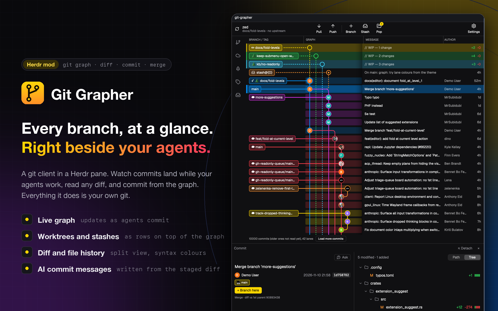
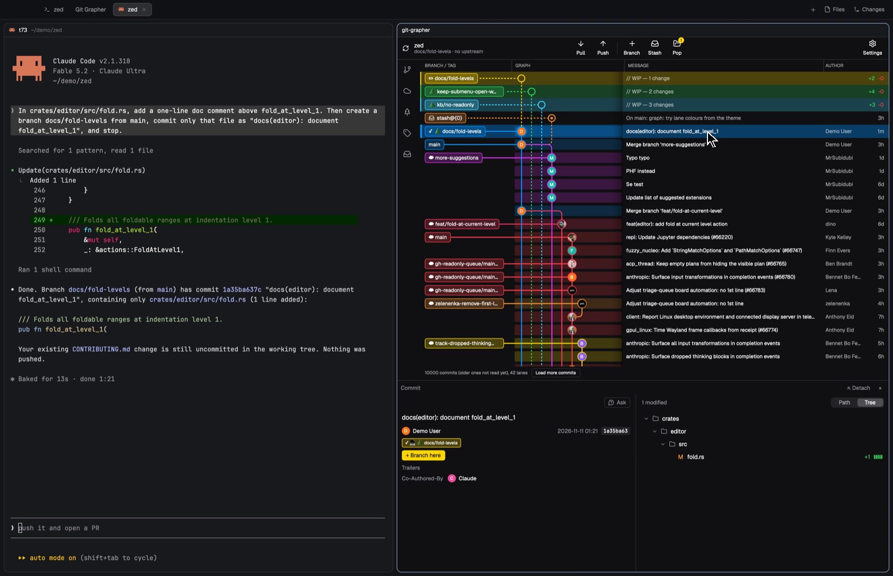
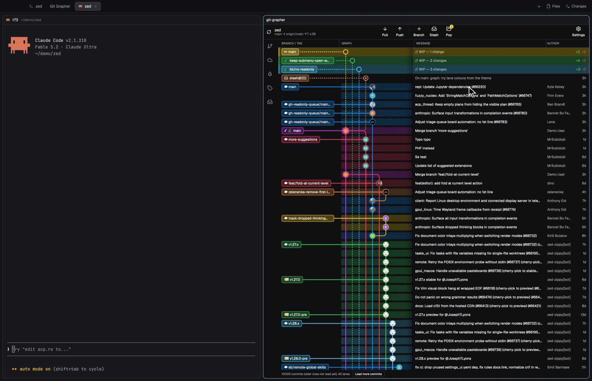
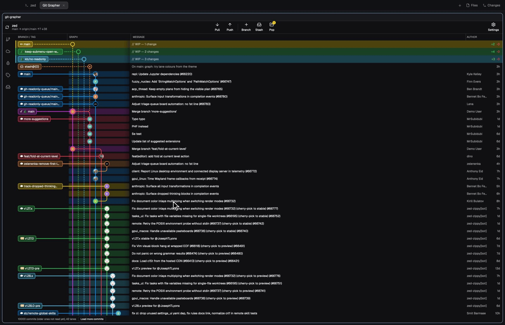

<p align="center"></p>

# Git Grapher

[](https://github.com/TomiXRM/git-grapher/releases)
[](https://github.com/TomiXRM/git-grapher/stargazers)
[](https://github.com/TomiXRM/git-grapher/releases)
[](LICENSE)

[](https://herdr.dev/mods)
[](https://github.com/TomiXRM/git-grapher/actions/workflows/release.yml)

A git client for [Herdr](https://herdr.dev): the commit graph, diffs and common git operations in a tab or pane. It runs your `git`; nothing is kept outside the repository.

Requires Herdr and git. Tested with Herdr 0.1.14 on macOS.

## Install

Paste this to your agent in Herdr (Claude Code, Codex, …):

```text
Install the Herdr mod Git Grapher from https://github.com/tomixrm/git-grapher
(herdr.dev/mods/tomixrm/git-grapher).
1. Read ~/.config/herdr-app/AGENTS.md and follow its steps for adding a mod.
   Read RECIPE.md in the repository first (the release archive has only the
   mod folder). Before installing, tell me what the mod runs and which hosts
   it contacts, and wait for my go-ahead.
   Take the mod folder from the latest release (git-grapher-<tag>.tar.gz),
   not from the main branch.
2. The helper is optional. If that release has ggit-helper-<target> for this
   machine, download it, check it against the release's SHA256SUMS and put it
   at ~/.config/herdr-app/mods/git-grapher/bin/ggit-helper (executable).
   If it has none for this machine and cargo is installed, build helper/ from
   the same tag with `cargo build --release` and put the binary there.
   Otherwise skip the helper.
3. Ask me whether to add keys for it, in the "global" section of
   ~/.config/herdr-app/keys.json:
     cmd-shift-g  open it in a new tab
                  {"command":"tab.new","args":{"mod":"git-grapher","name":"Git Grapher"}}
     cmd-alt-g    open it beside the focused pane
                  {"command":"pane.split","args":{"direction":"right","mod":"git-grapher"}}
   I may pick other keys. If a key is already used, show me what it does now
   and ask before replacing it.
4. Open the mod in a new tab.
```

It ends up in `~/.config/herdr-app/mods/git-grapher/`. Delete that folder to uninstall.

## Usage

Herdr has no button for opening a mod, so use a command (or ask your agent). From a terminal inside Herdr, in a git repository:

```sh
# new tab
herdr-app do tab.new '{"mod":"git-grapher","name":"Git Grapher"}'

# beside the focused pane ("down" for underneath)
herdr-app do pane.split '{"direction":"right","mod":"git-grapher"}'
```

Keys, in the `"global"` section of `~/.config/herdr-app/keys.json`:

```json
"cmd-shift-g": { "command": "tab.new", "args": { "mod": "git-grapher", "name": "Git Grapher" } },
"cmd-alt-g":   { "command": "pane.split", "args": { "direction": "right", "mod": "git-grapher" } }
```



## Features

- The graph refreshes as commits land, e.g. from an agent in the next pane.

  

- Click a commit for its files; click a file for the diff (Unified or Split, syntax-coloured with the helper). File History from the file's right-click menu; `↑` / `↓` to step through it.

  

- Each worktree with changes and each stash is a row at the top. Stage, write or **Generate** a message from the staged diff, commit.

  

- Right-click a branch or tag: check out, fetch, merge, compare with HEAD, create a branch / worktree / tag, delete, copy.

  

- Pull, Push, Branch, Stash, Pop in the toolbar, with ahead / behind counts.
- Merge conflicts: take a side, edit, save, commit the merge.
- Sidebar with branches, remotes, worktrees, tags, stashes.
- Image previews in diffs; PDF and HEIC with the helper.
- Zoom 70–200%. Four themes, or Herdr's.

  

## Helper

`ggit-helper` (Rust, in `helper/`) adds syntax colours and PDF / HEIC previews. Without it diffs are plain. Install it from **Settings → Updates → Install**, or build it:

```sh
git clone https://github.com/tomixrm/git-grapher && cd git-grapher/helper
cargo build --release
mkdir -p ~/.config/herdr-app/mods/git-grapher/bin
cp target/release/ggit-helper ~/.config/herdr-app/mods/git-grapher/bin/
```

## Updates

**Settings → Updates.** The gear shows `↑` when a newer release exists; **Update** replaces the mod and the helper. Files are checked against the release's `SHA256SUMS` first, and the previous version goes to `~/.config/herdr-app/backups/`.

Don't reinstall with your agent to update: Herdr never overwrites a mod, so you'd get a second copy.

## Network and programs

- `git`, in the repository of the pane it was opened from. Auto-fetch about once a minute while open. It watches that repository's folder for changes.
- **Ask** sends your question to an agent's terminal with `hc send`, or opens a pane running `claude` with it.
- Avatars: one request per author email to `avatars.githubusercontent.com` or `gravatar.com`.
- **Generate** runs a command with the staged diff (default `claude -p`, set in Settings).
- Once a day, one request to `github.com/tomixrm/git-grapher/releases/latest`. Downloads only on **Update** / **Install**.

## Notes

- Reads the newest 10,000 commits; **Load more commits** adds 1,000.
- All Herdr mods share one JS heap. On a very large repository, close copies you don't use.

## Development

```sh
npm test                    # all tests
scripts/dev-link.sh --watch # copy mods/git-grapher into Herdr on change
```

Test conventions: `docs/TESTING.md`. Herdr mod runtime notes: `docs/mod-tips.md`.

## License

MIT
