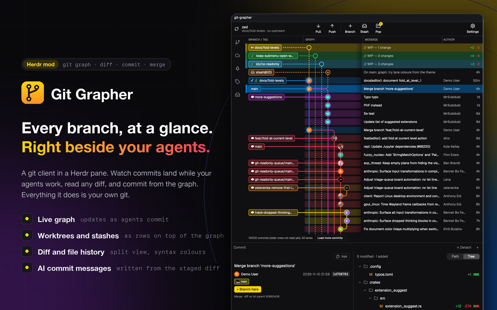

# Git Grapher

A git client in one Herdr mod. The person sees the commit graph of the repository their pane is in: coloured lanes on the left, one commit per row, branch and tag labels beside it, and rows on top for uncommitted work in every worktree and for every stash. Clicking a row opens its details, files and diffs. A toolbar pulls, pushes, branches and stashes. Everything is done by running the person's own `git`.

## What you see

Top to bottom, in one pane (dark theme "Apple Dark": background `#101012`, text `#ffffff`, dim text `#98989f`, accent `#ffd600`):

1. **Toolbar.** Left: a refresh icon, the repository name (bold) and under it `branch → upstream ↑ahead ↓behind` in dim text. Centre: Pull, Push, a divider, Branch, Stash, Pop, each an icon over a small label; Pop carries a yellow badge with the stash count. Right: Settings. When the pane is narrower than 640 / 500 / 340 px the buttons drop to labels, icons only, then an overflow menu.
2. **Sidebar rail**, a 50 px column of five icons: branches, remotes, worktrees, tags, stashes. Hovering or clicking one opens its list over the graph, with a filter box.
3. **Graph table** with a header row `BRANCH / TAG | GRAPH | MESSAGE | AUTHOR` (small dim capitals; the column dividers can be dragged). Rows are 29 px high:
   - **BRANCH / TAG**: rounded label chips in the lane's colour (outline + tinted fill). A local branch has a tree icon, a remote one a cloud, a tag a tag icon; the checked-out branch has a tick. A line joins the chip to its commit's node.
   - **GRAPH**: lanes 22 px apart, lines 2 px, eight lane colours (`#ffd600 #30d158 #3cd3fe #0091ff #db34f2 #ff375f #ff3d49 #ff9230`). A commit's node is the author's avatar (16 px circle; initials on a tint until the picture arrives). Merges curve into their lane. Each row has a faint band in its lane's colour from the node to the right edge of the column. The column scrolls sideways when lanes overflow, with soft shadow edges.
   - **MESSAGE**: the subject line. **AUTHOR**: name and a relative time (`3h`, `6d`).
   - On top: one `// WIP — n changes` row per worktree with changes (dashed lane, hollow node, `+added −removed` at the right) and one row per stash (dashed, inbox icon).
   - Footer: `10000 commits (older ones not read yet), 42 lanes` and a **Load more commits** button.
4. **Details drawer**, opened by selecting a row: on the right when the pane is wide, underneath when narrow. For a commit: subject, avatar, author, date, short SHA, ref chips, **+ Branch here**, the message body, trailers (`Co-Authored-By` with avatars), then `n modified · n added · n deleted` and the files as Path or Tree with `+n −n` and a five-block bar. For a WIP row: Unstaged and Staged lists with Stage / Unstage / Discard per file and for all, then Summary and Description fields, Template, **Generate**, **Commit**.
5. **Diff view**, replacing the graph when a file is clicked: a Back button, the path, `M +37 −3`, Wrap, Unified | Split. Line numbers, hunk headers in dim text, added lines on green and removed on red, changed words marked, syntax colours. **File History** (from a file's right-click menu) puts a list of that file's commits above the diff.

## How it behaves

- **Following the repository.** The view reloads when the worktree or `.git` changes (folder watch) and on a slow poll, so a commit made by an agent in a terminal appears within a second or two. New rows slide in. It fetches about once a minute while open (not during a pull).
- **Selecting.** Click a row: details open; click it again or press Esc: they close. `↑` / `↓` move the selection and the list follows. In File History `↑` / `↓` move through that list.
- **Right-click** a commit row: copy SHA / short SHA / message, create branch / worktree / tag here, revert, check out, compare with HEAD. Right-click a label: check out, fetch, compare with HEAD, merge into the current branch, create branch / worktree / tag there, rename, set upstream, delete, copy name / SHA. Right-click a file: File History, copy path, open in a new tab or the default editor.
- **Toolbar.** Pull shows what will happen before it runs. Results appear as a short bar at the bottom; failures show git's own message.
- **Committing.** In a WIP row's drawer, Stage / Unstage move files between the lists at once; Generate runs a command with the staged diff and fills Summary and Description; Commit is enabled when there is a summary and something staged.
- **Merging.** A merge with conflicts opens a conflict view: the files on the left, Current and Incoming side by side with their lines aligned; per conflict pick Current, Incoming or both, or use one side for the whole file, edit the result, Save, then commit the merge. Skip and Abort are in its title bar. `git` stays the source of truth: finishing or aborting the merge in a terminal is followed.
- **Settings** (top right): theme (Follow herdr, Apple Dark, Apple Light, Flower Road, Color Vision), zoom 70–200%, avatar nodes on / off, the Generate command, Verbose.
- **Loading.** A skeleton shows while a diff or details load. A repository with no commits, or a folder that is not a repository, shows a one-line note.

## Built from

- One mod, `mods/git-grapher/`, `mod.json` `{"place":"none","focusable":true}`. It is put in a tab (`tab.new {mod}`) or a pane (`pane.split {direction, mod}`); no layout is needed. With `props.role: "detail"` the same mod shows only the details (used when the drawer is detached into its own pane).
- `main.js` picks the view. `graph.js` is the graph and wiring; `header.js` the toolbar; `sidebar.js` the lists; `detail-view.js` and `commit-pane.js` the drawer; `conflict-view.js` merges; `lane-cell.js` draws a row's lanes; `settings.js`, `themes.js`, `menu.js`, `modal.js`, `ask.js`, `avatar.js`, `preview.js`, `colour.js`, `generate.js`, `drive.js`, `run.js`; `ui/` small components; `icons/` 34 [Lucide](https://lucide.dev) icons (ISC).
- `lib/` has no Herdr imports and is tested with `node --test`: `parse-log.js` (git log → commits), `layout.js` (commits → lanes and edges), `store.js` (one read at a time, first 10,000 commits, 1,000 more per Load more), `core.js` (every git write, each with a check before and after), `merge.js`, `conflict.js`, `detail.js`, `diff.js`, `lane-cache.js`, `lane-segments.js`, `redraw.js`, `view-decisions.js`.
- From `herdr`: `exec`, `watchFolder`, `shared` / `setShared` (settings under `ggit.settings`, per-tab selection under `ggit.tab.*`), `props`, `panes`, `spaces`, `focused`, `nextCommand`, `theme` / `themes`, `settings`, `appHome`, `pickFolder`, `hc`, and `run` for `pane.split`, `pane.close`, `tab.new`, `layout.resize`. From `gpui-kit` / `gpui-base`: `View`, `div`, `svg`, `image`, `v_virtual_list`, the path builder and `paint_path`, text inputs.
- Programs it runs: `git` (always; it also watches the repository folder), `hc send` (Ask: the question goes to an agent terminal, or a new pane runs `claude` with it), `sh` and `curl` (avatars: one GET per author email to `avatars.githubusercontent.com` or `www.gravatar.com`, saved under `data/ggit-avatars/`), the Generate command (default `claude -p`), and, if installed at `mods/git-grapher/bin/ggit-helper`, the optional helper (syntax colours for diffs, PDF / HEIC previews; source in `helper/`, Rust). Settings → Updates runs `update.sh` (sh, curl, tar, shasum): once a day a HEAD request to `github.com/tomixrm/git-grapher/releases/latest`; on **Update** / **Install** it downloads that release's `git-grapher-<tag>.tar.gz`, `ggit-helper-<target>` and `SHA256SUMS`, checks them, moves the old folder to `backups/git-grapher-<time>` and puts the new one in place. A folder with `.dev-link` (scripts/dev-link.sh) is never updated.

## Watch out

- **Shared memory.** All mods share one JS heap. Building a new path for every lane on every redraw used it up within minutes on a 10,000-commit repository and broke every mod until restart. Built `Path` objects are cached per row and reused; elements are not reusable (the host refuses an element from an earlier render). Straight vertical segments are plain divs. Do not cache elements, and do not build paths whose geometry depends on the scroll offset.
- **Virtual list rows cannot hold handlers.** Clicks come from `on_item_click` with the row key; the position inside the row is worked out from the press position.
- **A handler's `cx` dies after an `await`.** Do the work in `cx.spawn` and notify from the task's own context.
- **Icons must be real files** under `mods/git-grapher/icons/`: `svg()` does not read through a symlinked mod folder.
- **Copies do not share module state.** Each tab or pane loads the mod again; share through `setShared` only, and keep those values small.
- A sidebar list with thousands of remote branches is slow to open (it is not virtualised).
- Writes never guess: every git write checks the state it planned against, and reports refused / unknown instead of retrying.

## Done when

- In a git repository's space, `tab.new {mod:"git-grapher"}` shows the graph with the repository name and branch in the toolbar and no error in `herdr-app status`.
- `git commit` in a terminal makes a new top row appear without touching the mod.
- Clicking a commit opens its details; clicking a file shows a diff; Split shows two columns; File History lists that file's commits and `↓` moves the selection.
- Changing a file adds a `// WIP` row; Stage, a summary and Commit make a commit that `git log` shows.
- Right-click a branch label → Compare with HEAD shows a file list.
- Sixty redraws of an unchanged 10,000-commit graph do not reduce free JS memory.
- `npm test` passes.
